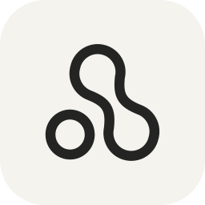

<h1 align="center">Lightfield</h1>

<p align="center">A new tab page that you actually want to open: animated backgrounds, your language of search, clock, weather, themes and type — all local, no account, no telemetry.</p>

<p align="center"></p>

<p align="center">
  <a href="#install"></a>
  <a href="#install"></a>
  <a href="package.json"></a>
  
</p>

## What you get

- **A background you like looking at.** Generated scenes — flowing gradients, grain, dither, light rays, fluid and glass studies — plus your own image, with image filters and a live effect tuner.
- **Search without leaving the page.** Google, DuckDuckGo, Bing, Brave, Ecosia, Kagi, Startpage and Qwant, behind one capsule that opens in place.
- **Time and weather, on your terms.** Clock and date with the formats you prefer, plus optional weather for a chosen city — or your device location, only if you grant it.
- **Looks that are yours.** Colour themes with light/dark badges, and custom themes you can duplicate, edit, import and export.
- **Type that fits.** Bundled open-source typefaces and the option to load your own font by URL.
- **Fast, keyboard-first settings.** `/` or `⌘K` to search, `,` for settings, `h` to hide the island, `Esc` to dismiss. Settings open as a floating modal or a side drawer; the choice is yours and it morphs into place.

## Install

Lightfield is not on any browser store yet, so installs go through a packaged build. Grab the archives from the [latest release](../../releases/latest) — each one ships `lightfield-chromium.zip` and `lightfield-firefox.zip` — unzip, then load it unpacked below. (Until the first tagged release lands you can also [build it yourself](#building-it-yourself).)

### Chromium browsers (Chrome, Edge, Brave, Opera, Vivaldi, Arc)

1. Open the extensions page — `chrome://extensions`, `edge://extensions`, `brave://extensions`, …
2. Turn on **Developer mode**.
3. Choose **Load unpacked** and select the unzipped folder.
4. Open a new tab. Lightfield replaces the default new tab page.

### Firefox

1. Open `about:debugging#/runtime/this-firefox`.
2. Choose **Load Temporary Add-on…** and select the `manifest.json` inside the unzipped folder.
3. Open a new tab.

Firefox only keeps temporary add-ons until you restart the browser. Permanent installs need a signed, listed build, and the development Gecko ID in `tooling/manifest.ts` has to be replaced with a real one before any distribution — see [Release readiness](#release-readiness).

### Building it yourself

```sh
bun install
bun run build          # or: bun run build:chromium / bun run build:firefox
```

That writes `dist/chromium`, `dist/firefox` and the packaged archives `artifacts/lightfield-chromium.zip`, `artifacts/lightfield-firefox.zip`, which load with the same steps above.

### After installing

- Press `/` (or `⌘K` / `Ctrl+K`) to search, `,` to open settings.
- Weather asks before it uses anything: enable it in **Time & Weather**, type a city, or explicitly allow device location.
- Loading a custom font asks the same way, and only contacts Google Fonts after you approve an exact URL.
- Everything else — search, backgrounds, themes, time — works offline.

## Privacy

No accounts, no analytics, no telemetry, no remote config. All settings live in local extension storage.

The only network calls this extension can make are the features you switch on:

| Feature         | Where it goes                                        | When                                                                    |
| --------------- | ---------------------------------------------------- | ----------------------------------------------------------------------- |
| Weather         | `api.open-meteo.com`, `geocoding-api.open-meteo.com` | Only while weather is enabled; city lookup or coarse device coordinates |
| Custom fonts    | `fonts.googleapis.com`, `fonts.gstatic.com`          | Only after you paste a specific font URL and approve it                 |
| Device location | the browser's own geolocation (no third party)       | Only after an explicit gesture, and you can revoke it later             |

Those hosts are exactly the ones declared in the manifest's `connect-src`; there is nothing else. Permissions are deliberately narrow: `storage` only, plus Firefox's optional `geolocation` and one optional host permission for font loading. Weather and fonts stay off until you ask for them.

## Development

Requires [Bun](https://bun.sh) 1.4.2 (Node 24+ is also understood).

```sh
bun install
bun run dev        # builds both targets and opens isolated Chrome + Firefox with disposable profiles
bun run dev --headless      # same, without windows (automation)
bun run dev --no-fixtures   # start with an empty custom-theme collection
bun run validate   # types, lint, formatting, dead code, tests, both builds, package inspection, Firefox lint
```

`bun run dev` never touches your normal browser profiles: it provisions pinned browsers into a user cache directory, owns temporary profiles, and reloads only its own pages on rebuild.

The codebase is small and deliberately layered:

| Path           | What lives there                                                                     |
| -------------- | ------------------------------------------------------------------------------------ |
| `src/ui`       | Svelte shell: new tab island, search, settings sections, theme manager, font manager |
| `src/effects`  | Background engines (Three, OGL, paper shaders), image filters, runtime loaders       |
| `src/domain`   | Settings schema and theme/search/weather rules                                       |
| `src/services` | Storage, weather, custom fonts, reduced motion, persistence                          |
| `src/platform` | Browser-specific concerns and local image storage                                    |
| `tooling`      | Build, packaging, manifest generation, managed dev browsers, inspection              |

## Release readiness

Known gaps before this can be published anywhere:

- No store listing or signed build yet; Firefox needs a real Gecko ID and a signed upload.
- Some bundled artwork and third-party sources carry terms that need review before redistribution — the exact list, licences and hashes are in [THIRD_PARTY_NOTICES.md](THIRD_PARTY_NOTICES.md).
- Firefox's own data-collection declarations (remote fonts, search, location) still need to be answered for a listed release.

## Open source

- **Licence:** [MIT](LICENSE) for this project. Bundled third-party assets keep their own licences.
- **Third-party notices:** [THIRD_PARTY_NOTICES.md](THIRD_PARTY_NOTICES.md) documents every bundled background, brand mark, icon and font with its upstream source, licence and hashes.
- **Contributions:** issues and pull requests are welcome. Please run `bun run validate` before opening one; there is no CI yet, so local validation is the gate. Keep the existing structure and don't commit `dist/` or `artifacts/`.
- **Credits:** backgrounds adapted from [React Bits](https://github.com/DavidHDev/react-bits); search marks from [`thesvg-color`](https://github.com/glincker/thesvg) and [`selfhst`](https://github.com/selfhst/icons) found via [icons0.dev](https://icons0.dev); shader icon glyph from [Catppuccin VS Code Icons](https://github.com/catppuccin/vscode-icons); typefaces from [Google Fonts](https://fonts.google.com) (OFL); rendering via [Three.js](https://threejs.org), [OGL](https://github.com/oframe/ogl), [postprocessing](https://github.com/pmndrs/postprocessing) and [Paper shaders](https://github.com/paper-design/shaders).
